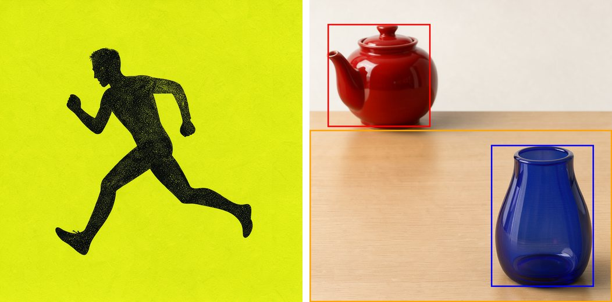
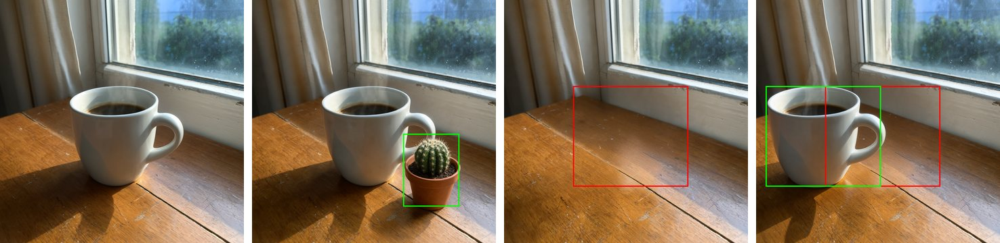

# 🖼️ FLUX 3 Image Klein for Forge Neo

> **Extension for [Stable Diffusion WebUI Forge - Neo](https://github.com/Haoming02/sd-webui-forge-classic/tree/neo)**

Generate with **[FLUX 3 Image Klein](https://huggingface.co/black-forest-labs/flux-3-image-klein)** inside Forge Neo, using the checkpoint, preset and Generate button you already know - text-to-image, editing with up to 10 reference images, and layouts drawn with boxes in the prompt, even on 8 GB GPUs.

> [!Important]
> This extension requires an up-to-date **Forge Neo** (the `neo` branch). On an older version it stays disabled and tells you so in the console - Forge Neo itself keeps working as usual.

---

## 📋 Table of Contents

- [What's New](#-whats-new)
- [Features](#-features)
- [Installation](#-installation)
- [Recommended Settings](#%EF%B8%8F-recommended-settings)
- [Tips](#-tips)
- [Credits](#-credits)

---

## 🆕 What's New

### v0.1.0 - First Release

- **FLUX 3 Image Klein in Forge Neo** - the 16-step distilled model and the base model, in BF16, INT8 and NVFP4 files.
- **Reference images** - edit a picture, or combine up to 10 of them, with img2img and ImageStitch.
- **Layout by boxes** - place, add, move or remove things by giving their boxes in the prompt.
- **flux3 UI preset** and **FLUX.3** schedule - ready to generate.
- **Older GPUs** - works on cards without bf16 (RTX 20xx), tested on an 8 GB RTX 2070.

---

## 🎯 Features

> [!Tip]
> Every example below, in full resolution and with its prompt and settings, is in the **[wiki](https://github.com/eduardoabreu81/flux3-image-forge-neo/wiki)**.

### 🖼️ Native Generation

- Runs inside txt2img and img2img - no separate tab, no extra environment
- Works with the Forge Neo model folders and the **VAE / Text Encoder** selector you already use
- Uses the same text encoder as Krea 2 and Iris 3B, and the same autoencoder as FLUX.2 - if you have them, you already have these files
- **Distilled** model: an image in 16 steps - about 25 seconds at 1024x1024 on an RTX 2070 with the INT8 file
- **Base** model: 50 steps with CFG, made for LoRA training and research
- Loads the light INT8 files for 8 GB GPUs, the full BF16 files, and NVFP4 for RTX 50 cards

### 🧩 Reference Images

- **One picture:** img2img with **Settings** → **[Klein] Enable Reference** on - the input becomes the reference, and the prompt describes the result
- **Several pictures:** add them in **ImageStitch Integrated**, in txt2img or img2img, up to 10, and refer to them in the prompt as "the first image", "the second image"...
- An edit with one reference takes about a minute on an RTX 2070; three references, about a minute and a half

### 📐 Layout by Boxes

- Tell the model where each thing goes: add a list of boxes at the end of the prompt, in the format of [Black Forest Labs' guide](https://docs.bfl.ai/flux_3/flux3_image_bounding_boxes)
- Each box is `[top, left, bottom, right]` on a 0-1000 grid, with a short description, and the caption mentions it by its name, such as `<vase_1>`
- Works with **sd-dynamic-prompts** installed

### ✂️ Edit by Boxes

- With a reference image, add, remove, move or replace things by giving their boxes: where they are in the reference and where they should go
- A box with no destination removes the thing; the rest of the picture stays as it was

### 🔌 LoRA

- FLUX 3 LoRAs through Forge's usual `<lora:name:weight>` syntax, with the BF16 and INT8 files alike

### 🛡️ Safe by Design

- Changes no Forge Neo file - remove the extension and everything is as it was
- Checks your Forge Neo at startup and stays disabled if something it needs is missing
- Tells you which file is missing under **VAE / Text Encoder** instead of failing with a generic error
- Other models are not affected

---

## 📦 Installation

1. Open Forge Neo WebUI
2. Go to **Extensions** → **Install from URL**
3. Paste: `https://github.com/eduardoabreu81/flux3-image-forge-neo`
4. Click **Install** and restart the WebUI
5. Accept the license on [black-forest-labs/flux-3-image-klein-comfy](https://huggingface.co/black-forest-labs/flux-3-image-klein-comfy) and place the files in the usual folders:

| Part | File | Folder |
| :--- | :--- | :--- |
| FLUX 3 checkpoint, distilled | `flux3_image_klein_sd_int8_convrot` (8 GB GPUs), `flux3_image_klein_sd_bf16` or `flux3_image_klein_sd_nvfp4` (RTX 50) | `models/Stable-diffusion` |
| FLUX 3 checkpoint, base (optional) | `flux3_image_klein_int8_convrot`, `flux3_image_klein_bf16` or `flux3_image_klein_nvfp4` | `models/Stable-diffusion` |
| Qwen3-VL 4B text encoder | `qwen3vl_4b_int8_convrot` or `qwen3vl_4b_bf16` - Krea 2's `qwen3vl_4b_fp8_scaled` works too | `models/text_encoder` |
| FLUX.2 autoencoder | `flux2-vae` | `models/VAE` |

Files with `_sd_` in the name are the distilled model; the others are the base model.

6. Pick the **flux3** UI preset, the checkpoint, and the text encoder and autoencoder under **VAE / Text Encoder**

---

## ⚙️ Recommended Settings

| Model | Sampler | Schedule type | Steps | CFG |
| :--- | :--- | :--- | :--- | :--- |
| **Distilled** (`_sd_`) | Euler | FLUX.3 | 16 | 1 |
| **Base** | Euler | FLUX.3 | 50 | 3.5 |

The **flux3** preset sets the distilled model's values. Leave the **negative prompt** empty, and use sides that are a multiple of 16. For edits with a reference, use **Denoising strength** 1.

---

## 💡 Tips

- Write full captions - framing, subject, background, lighting. Short prompts give generic pictures
- For edits, describe the whole picture you want with the change folded in - a short instruction such as "make it blue" can change the framing
- Use Euler and the FLUX.3 schedule with the distilled model; other samplers and schedules give worse pictures
- With **[Klein] Enable Reference** on, every img2img input also becomes a reference - turn it off for plain img2img variations
- A batch of different prompts fails in Forge Neo with this model, as with FLUX.2 Klein - generate them one at a time
- New text encoder files appear in the list after a restart of Forge Neo
- Before uninstalling, switch the UI preset to another one

---

## 📄 Credits

- **[Forge Neo](https://github.com/Haoming02/sd-webui-forge-classic/tree/neo)** by Haoming02
- **[FLUX 3 Image Klein](https://huggingface.co/black-forest-labs/flux-3-image-klein)** by Black Forest Labs - the model, its [reference code](https://github.com/black-forest-labs/flux-3-image-klein) and the mug photo of the box-edit examples
- **[ComfyUI](https://github.com/comfyanonymous/ComfyUI)** by comfyanonymous - the first implementation outside the reference code, and the INT8 files
- **[Qwen3-VL](https://huggingface.co/Qwen/Qwen3-VL-4B-Instruct)** by the Qwen team - the text encoder

The FLUX 3 Image Klein weights are released under the [FLUX Kommunity License](https://huggingface.co/black-forest-labs/flux-3-image-klein-comfy/blob/main/LICENSE.md); this extension does not include them.

---

## 📜 License

AGPL-3.0 - see [LICENSE](LICENSE)

---

Made with ❤️ for the Stable Diffusion community

**[Report Bug](https://github.com/eduardoabreu81/flux3-image-forge-neo/issues)** • **[Request Feature](https://github.com/eduardoabreu81/flux3-image-forge-neo/issues)** • **[☕ Ko-fi](https://ko-fi.com/eduardoabreu81)**

